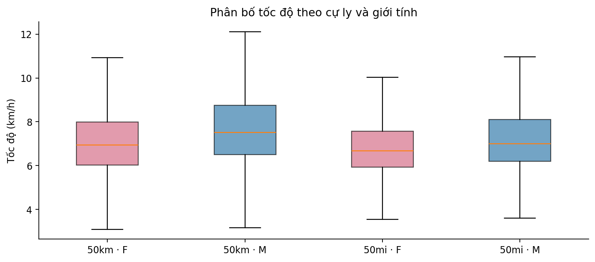

# Ultra-marathons in the USA, 2020 — descriptive analysis

Speed and participation in 50 km and 50 mile races held in the USA in 2020, using pandas and matplotlib. The project started from a tutorial notebook (original link lost) and was then extended with:
- a better country filter, which recovers 434 results the old filter missed,
- handling of missing ages,
- detection of conflicting athlete IDs,
- sensitivity checks on weighting and season.

🇻🇳 Notebook giải thích bằng tiếng Việt: [Ultra_marathon_hoan_chinh.ipynb](Ultra_marathon_hoan_chinh.ipynb)



## Findings

There are 26,524 race results, from 21,594 source athlete IDs and 502 race editions.

| Distance | Gender | Results | Mean speed (km/h) | Share of field |
|---|---|---:|---:|---:|
| 50 km | F | 6,982 | 7.09 | 33.5% |
| 50 km | M | 13,843 | 7.74 | 66.5% |
| 50 mi | F | 1,591 | 6.83 | 27.9% |
| 50 mi | M | 4,108 | 7.25 | 72.1% |

- **Gender gap within the same race:** the median gap (men minus women) is 0.74 km/h at 50 km (220 races) and 0.49 km/h at 50 mi (45 races). Only races with at least 10 runners of each gender are counted.
- **Age:** runners aged 20–29 are fastest (8.05 km/h at 50 km). Speed falls steadily to 6.08 km/h for 70+.
- **Season:** summer races are the slowest for both distances, at 6.96 km/h for 50 km and 6.51 km/h for 50 mi.
- **Weighting:** counting each athlete once instead of each result changes mean speeds by at most 0.002 km/h.

All comparisons are descriptive. Course difficulty, weather and who chooses to enter are not controlled for.

## Data and cleaning

- Source: [The Big Dataset of Ultra Marathon Running](https://www.kaggle.com/datasets/aiaiaidavid/the-big-dataset-of-ultra-marathon-running). It has 7,461,195 rows (about 828 MB), read in chunks.
- [data/um_usa_2020_50k_50mi.csv](data/um_usa_2020_50k_50mi.csv) holds the filtered scope: USA, 2020, 50 km and 50 mi, all 13 original columns. Row counts and SHA-256 are in [data/manifest.json](data/manifest.json).
- The country comes from the last bracket in the event name. Date ranges use the start date to assign month and season.
- 235 results without age are kept for every analysis that does not need age.
- Speed was checked against distance and finish time. The largest difference is under 0.0005 km/h, so no rows were removed.
- 255 athlete IDs have conflicting attributes (687 results). Their results are kept, but they are excluded when weighting by athlete.

## Run

```bash
pip install -r requirements.txt
python run_analysis.py      # writes tables and 4 charts to results/
```

To rebuild the filtered file from the full Kaggle CSV, place `TWO_CENTURIES_OF_UM_RACES.csv` in the project folder. On Windows, set `PYTHONUTF8=1` if the terminal shows encoding errors.

## Limitations

- Athlete IDs come from the source and are not verified as unique people.
- 2020 was a pandemic year with many cancelled races, so the season pattern may not be typical.
- No course elevation or weather data.
